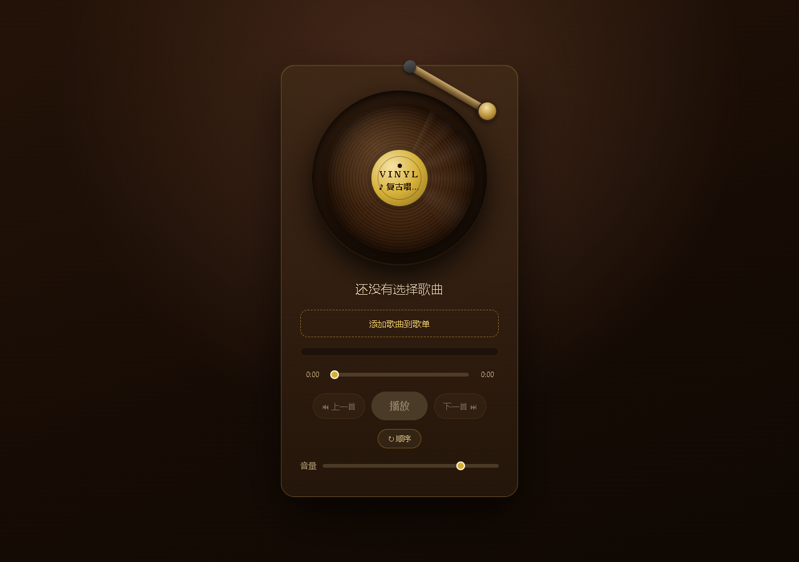

# Music Player 🎵



一个用原生 HTML / CSS / JavaScript 写的网页音乐播放器——**零框架、零依赖、开箱即用**，复古黑胶唱片机外观，点开即播。

**在线体验：** 👉 https://andykkcode.github.io/music-player

---

## 功能 Features

- **本地音乐导入**：一次选择多首，浏览器直接播放，音乐文件不上传任何服务器
- **歌单管理**：添加、删除、点击切换、当前播放高亮
- **播放控制**：上一首 / 下一首、进度条拖动跳转、音量调节、播完自动切歌
- **三种播放模式**：顺序播放 / 单曲循环 / 随机播放
- **黑胶唱片机外观**：播放时唱片旋转、唱臂落下，唱片标签实时显示当前歌名

## 技术栈 Tech Stack

`HTML5 Audio API` · `CSS3` · `Vanilla JavaScript` — no frameworks, no build tools, no dependencies.

## 本地运行 Local Development

下载本仓库，双击 `index.html` 即可，无需安装任何环境。

```bash
git clone https://github.com/Andykkcode/music-player.git
cd music-player
# 双击 index.html 直接打开
```

## 使用说明 Usage

1. 点击「添加歌曲到歌单」，从本地选择音乐文件（mp3 / wav / ogg 等浏览器支持的格式）
2. 点击歌单里的歌曲即可播放
3. 播放时唱片会旋转、唱臂落下；点击模式按钮可在顺序 / 单曲循环 / 随机之间切换

> 提示：音乐文件只在本机浏览器中读取，不会上传到任何服务器。

## 版权说明 Copyright

仓库中不含任何受版权保护的音频文件，播放器仅读取用户本地音乐，版权归原作者所有。

## License

[MIT](LICENSE)
